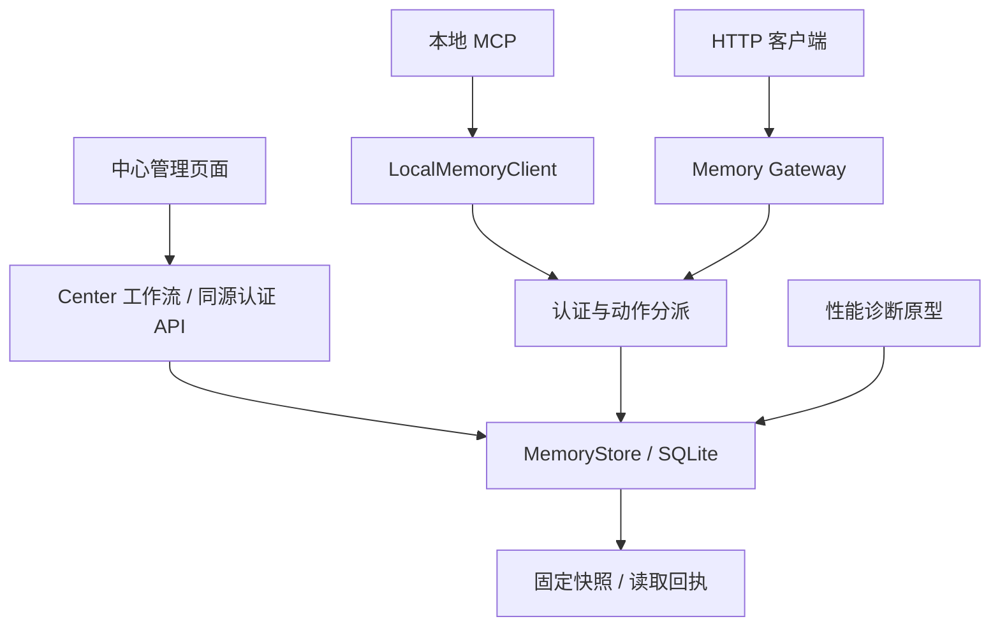
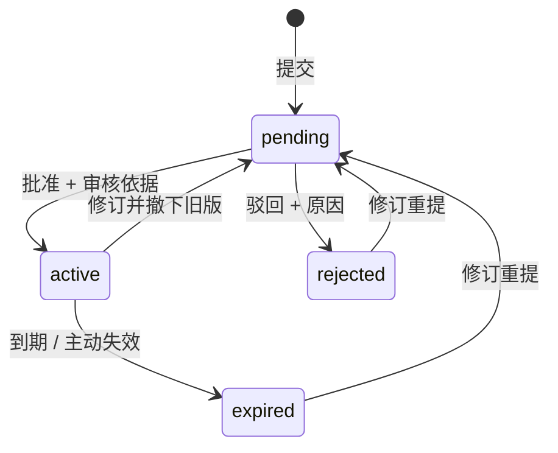

# Relax 项目记忆中心：技术设计

状态：2026-11-10 设计与实现说明。目标架构和当前 Demo 在每节明确区分。配套：[产品方案](./memory-center-product.md)、[Demo 手册](./memory-center-demo.md)。

## 1. 设计目标与原则

提供与业务模型解耦的项目知识/经验模块；Python 本地运行，无 GPU 或 Docker 前提。相同记录语义服务于网页、CLI、MCP 和未来平台 SDK。先保证来源、审核、版本、隔离与可重放，再增强语义检索和自动整理。

原始代码、日志、报告是事实来源；经验是有范围的结论；配方是有版本的执行引用。记忆中的命令始终是参考数据，不产生执行授权。中心批准与训练奖励也不是同一个可信信号。

## 2. 架构与模块



图表示组件复用关系，不表示当前 Demo 默认共用同一个数据库。中心工作流使用专用实例，性能原型、HTTP 网关实例分别显式配置状态目录。不要把管理 Demo 的数据库直接接给未完成权限适配的公共网关。

| 文件 | 当前职责 |
| --- | --- |
| `relax/memory/store.py` | 候选、验证决定、版本、TTL、快照、检索与读取回执 |
| `relax/memory/client.py` | HTTP 客户端与本地直连客户端 |
| `relax/memory/mcp.py` | stdio MCP 的 search/get/propose/feedback |
| `relax/memory/server.py` | 管理/任务绑定凭证与 HTTP 动作分派 |
| `relax/memory/center.py` | 中心 Demo 表单校验、审批状态、生命周期扫描和网页 API |
| `relax/memory/center.html` | 无外部资源依赖的管理页面 |
| `examples/memory/center_demo.py` | Linux 后台启动、检查状态、停止自身进程 |
| `examples/memory/performance.py` | 静态脚本、规范日志、Chrome trace 与历史案例诊断 |
| `examples/memory/sync.py` | 显式发布候选、固定快照检索结果缓存 |
| `examples/memory/performance_demo.py` | 本地/MCP/临时远端的完整演示流程 |

## 3. 当前中心库数据结构

底层复用 `MemoryStore` 的 records、candidates、snapshots、receipts 等表。中心另加两张演示工作流表：

- `center_entries`：稳定 ID、当前表单 body、状态、工作流 version、候选引用、正式记忆 ID/revision、创建与更新时间。
- `center_events`：递增事件编号、词条 ID、动作、操作人、说明、时间以及当时表单内容。

工作流版本用于避免两个页面覆盖修改；记忆 revision 用于固定 Agent 读取的正式版本。提交、审核等工作流动作不必等同于一次正式记忆修订。

驳回状态当前由中心工作流管理，底层候选仍保留以便追溯，因此不能把裸 `candidate_list` 当作中心审批列表。中心接口不接受客户端切换 namespace，固定使用 `center/demo`。

## 4. 标准格式与字段映射

中心提交示例（可直接作为 `args.body`）：

```json
{
  "title": "区分编译冷启动和稳态训练耗时",
  "summary": "首步加速不等于稳态吞吐加速。",
  "kind": "strategy",
  "topic": "性能优化",
  "tags": ["编译缓存", "测量口径"],
  "conditions": "相同模型、数据工作量和并行配置；分别比较冷启动与热缓存。",
  "content": "记录首步耗时、稳定 step 分布与缓存命中情况，不混报局部和端到端收益。",
  "source": "examples/models/kimi-k3/OPTIMIZE.md",
  "evidence_level": "documented",
  "owner": "Relax 团队",
  "review_after": "2027-01-01T00:00:00+00:00",
  "expires_at": "2027-02-01T00:00:00+00:00"
}
```

日期仅示意格式，不代表适用于当前操作的默认有效期。字段校验：标题、摘要、正文、来源和负责人必填；标题最多 200 字符，整条表单最多 48 KB；最多 12 个标签，每个最多 50 字符；复核日期不得晚于到期日期。

类型为 `strategy | lesson | episode`。证据等级为 `documented | tested | hypothesis`，属于声明而非自动验证结果。日期必须带时区，保存时转换为 UTC ISO8601；页面按浏览器本地时区录入和显示。空日期保存为 `null`。

入库时映射为 Memory Record v1 当前子集：

| 中心字段 | Memory Record 字段 |
| --- | --- |
| kind / topic | kind / domain |
| title / summary | title / summary |
| content / conditions / tags / evidence_level | content 对象 |
| source | evidence 的 reference 与内容 hash 生成的 evidence_id |
| 中心 ID / owner | extensions.center |
| 审核人、理由、证据引用 | verification.verifier_id / claims / evidence_ids |
| expires_at / review_after | lifecycle |
| 正式 ID / revision / namespace | 服务生成，不接受表单伪造 |

早期完整标准中的代码指纹、结构化反例、实验基线、关系和受控 evidence 对象仍为目标契约。当前 Demo 的 source 是文本引用，不自动证明文件存在或实验真实发生，也不是证据对象存储。

## 5. 生命周期



`review_after` 不改变上述状态：已生效记录到了复核时间会展示 `needs_review=true`，但仍可进入快照。到期或主动失效停止进入新快照；新版本需要重新审批，不能通过修改时间悄悄恢复可读。

`MemoryStore.commit` 支持可选 `expires_at` 和 `review_after`。日期规范化后写入生命周期；精确去重同时比较生命周期设置，避免把不同有效期的请求吞成旧记录。

`create_snapshot` 在一次固定时间判断下，仅选择最新且已提交、尚未到期的版本。过期扫描不是正确性的唯一保障；即使中心扫描尚未运行，到期内容也不会进入新快照。

旧快照包含当时物化的内容，不随过期、修订或驳回改变。隐私强制删除和安全撤销需要额外的阻断机制，目前未实现，不可把普通 TTL 当成即时撤销。

## 6. 审批与一致性

中心提交调用 `stage`，审核通过调用 `commit`。批准必须包含理由，失败假设也可作为受限经验保存，但必须在 evidence_level 和审批 claims 中保留不确定性。审批不会自行运行测试。

修订和主动失效携带 `version`；不等于当前工作流版本则返回冲突错误，页面提示刷新。底层更新正式记录继续使用 `expected_revision`。

Demo 在一个服务进程内使用锁串行化管理动作，SQLite 持久化数据。中心状态、操作事件与底层记忆写入位于同一个外层事务；MemoryStore 通过嵌套 savepoint 组合操作。写入途中失败会整体回滚，不留下底层已批准而页面仍待审批的状态。生产仍需请求幂等、跨服务工作流恢复和运维设计；Demo 按单服务实例部署。

审批工作台与操作历史负责当前 Demo 的追溯，不是不可篡改审计。真实身份、审批分权和保留策略属于生产化边界。

## 7. 浏览器 API

默认中心监听 `127.0.0.1:8766`。`--host`、`--port` 可覆盖，端口 0 由系统分配。管理 API 必须使用独立中心密钥的 Bearer 认证；有 Origin 时要求与 Host 同源，未开放 CORS。

| 接口 | 含义 |
| --- | --- |
| `GET /` | 静态管理页面，不包含密钥或词条数据 |
| `GET /health` | 服务存活，返回服务标识 |
| `GET /api/state` | 受保护的中心词条、最近 150 条事件、服务器时间 |
| `POST /api/action` | 受保护的工作流动作；请求体最大 64 KB |

动作请求统一为 `{"action": "...", "args": {...}}`：

| action | args | 结果 |
| --- | --- | --- |
| submit | body、actor、可选 note | 创建待审批 ID |
| approve | id、version、actor、note | 批准并创建正式记忆版本 |
| reject | id、version、actor、note | 保留候选及驳回原因 |
| revise | id、version、body、actor、可选 note | 修改内容/有效期后重新审批 |
| expire | id、version、actor、note | 主动失效 |
| preview | 可选 query | 新快照内最多 20 条、65536 字节的真实读取回执 |

响应状态：缺少/错误认证或跨域为 403；输入不合法、状态或版本冲突为 400；存储错误为 503。完整多租户 API 将进一步细分 409、权限范围和幂等语义。

词条 HTML 全部按文本转义展示，不执行内容中的 HTML、脚本或命令。页面不加载第三方 CDN。认证密钥只在页面内存中使用；带 fragment 的演示链接加载后立即清除 fragment，不发送给服务器日志。链接持有人拥有全部 Demo 管理权限，生产应替换为 TLS/SSO 会话与服务端角色授权。

## 8. 本地、远端和同步契约

本地 MCP 使用 `LocalMemoryClient`，仍认证绑定 namespace/session/snapshot 的任务凭证，经同一 `dispatch` 分派，不因更换传输而授予管理权限。能直接读取数据库文件的 OS 用户不在此隔离边界内。

远端发布只复制明确选定的候选字段，丢弃原始 verification，等待目标审核。拉取使用任务凭证，对授权固定快照检索；校验回执 hash 和条目 ID/revision 后复制到独立缓存子空间，保留远端来源、版本和审核声明。

每次 pull 创建新的缓存子空间，不与上次混合。此路径是有预算的检索结果物化，不是全库原子镜像，不支持远端删除增量、自动刷新和离线立即撤回。

目标同步协议需要分页 manifest、版本游标、删除/停用事件、凭证撤销策略、选择性订阅和幂等发布回执。明确禁止以本地副本修改自动覆盖远端记录。

## 9. 性能专题与诊断契约

当前规则原型仅支持：选定脚本参数的静态文本观察、规范 `MEMORY_METRIC` 日志行及 OOM 提及次数、Chrome complete kernel 事件。不会执行输入脚本，不解析实际 shell 展开；trace 按 pid 跨 stream 取时间区间并集，算子累计时长不等于端到端时长。

每条建议保存命中的历史版本、当前 input hash、观察依据、缺失条件和下一步。没有直接输入支持时标记为历史备选。历史文档入库只核对出处，不自动认证历史实验收益。

目标性能案例需补齐：基线与变更变量、代码/依赖/模型/数据版本、硬件/拓扑、序列与 batch 分布、指标口径、预热与重复测量、数值与梯度校验、端到端成本，以及前置优化关系。错误归因比漏掉建议更危险，因此证据不足时返回待验证项。

## 10. 项目知识建设与平台接入

首次整理应覆盖授权的代码、文档、skills、内部优化材料、历史实验报告及问题复盘，先建立知识地图和来源清单，再形成专题案例。自动索引事实与自动批准结论分开。

增量更新按来源版本定位受影响条目，标记需复核；不因无关文件改动使全库失效，也不把一次旧失败永久判为不可用。知识覆盖视图展示缺材料、缺基线、缺验证和来源过时，而不是宣称助手“了解全部”。

平台接入使用受控运行、产物、报告引用。Agent 可从其授权来源获取详情；共享经验不能携带越权报告内容或绕过原始权限。当前未连接内部平台 API 或外部文档服务。

## 11. 部署、容量与恢复

Demo 仅使用 Python 标准库，SQLite WAL；状态目录保存 memory.sqlite、center-key、listen.json 和 server.log。建议指定容器已有持久化挂载目录。启动器不管理 Docker、数据库集群或模型服务。

正式共享服务可以迁移 PostgreSQL 与对象存储，但需要同时完成身份、权限、事务、容量与备份设计，不把存储替换描述为已实现 HA。网页当前返回全量词条和最近 150 条事件，适合小规模演示；生产必须分页、限制查询并为证据单独授权。

备份应停止自身 Demo 服务后复制完整状态目录，或用 SQLite backup API；不能在 WAL 写入中只复制主文件。重启沿用状态目录，不重复初始化已有词条。密钥、日志和状态目录不提交仓库。

## 12. 验证与演进

CPU 回归覆盖审批可见性、驳回/重提、版本冲突、TTL 新旧快照、来源历史保留、HTTP 认证与跨域、种子重复初始化、Agent 读取预览。独立性能流程验证真实本地 MCP、HTTP 选择发布、缓存与第二业务隔离。

当前没有运行 GPU 训练、真实 MemOS 服务或真实客户端自动激活验证。完整 Agentic 训练集成还要绑定 cohort、奖励后提交、私有暂存、token/mask 和恢复；不能由本次网页 Demo 推导这些能力已完成。

下一阶段优先：统一中心与性能助手协议 → 加入应用级证据/来源更新 → 接真实运行记录 → 身份和审批分权 → 跨服务恢复与增量同步。检索增强和记忆策略训练在有可比效果证据后推进。
