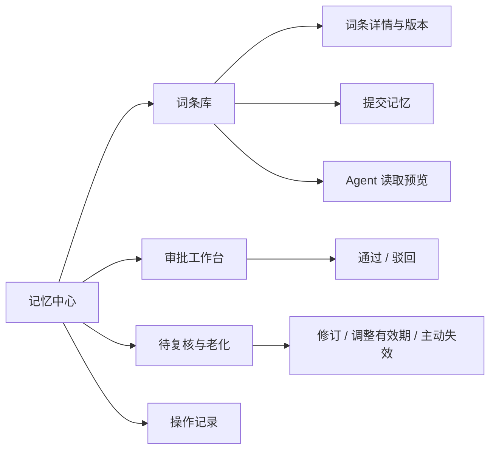

# Relax 项目记忆中心：产品方案

状态：产品设计与可运行 Demo，2026-11-10。本文覆盖目标产品和当前交付边界，不代表所有规划已实现。

配套文档：[当前设计总结](./memory-center-summary.md)、[技术设计](./memory-center-design.md)、[Demo 操作手册](./memory-center-demo.md)、[早期原生记忆方案](./native-memory-design.md)。

## 1. 产品定位

让用户和原 Agent 熟悉一个项目的架构、优化方向、历史案例、成功方法和失败教训，并在具体任务中找到可核对、适用且未过期的经验。

记忆中心服务于下一次决策：用户给出当前代码、脚本、日志或 trace，助手先理解问题，再查项目知识和历史案例，说明哪些结论有当前证据、哪些只是待验证假设。任务结束后形成候选，按权限审核、复用和共享。

产品独立于业务模型，不需要 GPU、Docker-in-Docker 或 MemOS 才能工作。用户继续在仓库、IDE、Codex/Claude Code 等原入口工作；网页承担知识查看、录入与治理，CLI/MCP 承担 Agent 交互。

## 2. 与平台的关系

平台文档强调：用户修改代码和数据，提交训练，获取模型和评估报告，再决定下一轮。Memory 补充“为什么做、过去做过什么、什么条件下值得复用”，不替代实验管理或流程编排。

| 责任方 | 负责内容 | 边界 |
| --- | --- | --- |
| 平台 | 运行 ID、代码/数据/模型版本、资源、日志、产物与评估报告、流程恢复 | 运行事实的权威来源，不自动将高分变成通用经验 |
| Relax Memory | 知识索引、经验条目、适用条件、审核、生命周期、固定快照与引用 | 引用平台事实，避免重复建设完整实验平台 |
| 原 Agent | 结合当前代码和历史证据提出诊断与候选 | 无权自行批准、提升共享范围或执行记忆中的命令 |
| 用户与维护者 | 确认结论、采用方案、审核发布、处理失效 | 采用和发布不由一次检索隐式授权 |

单 Pod 无平台时仍可工作；接入平台后再增加运行和报告引用。开发者查看评估报告的知识空间与训练样本可读记忆空间分开，防止评测答案进入训练上下文。

## 3. 用户与任务

目标角色包括项目开发者、优化工程师、业务维护者和知识管理员。目标产品区分提交者、审核者、发布者及读者；当前 Demo 只有一个管理访问密钥，所有操作具有相同权限，操作人名称仅用于演示记录，不能视为真实身份认证。

典型任务：

1. 新成员了解某个性能方向有哪些代码、配置和历史案例。
2. 给出当前脚本、日志或 trace，得到有证据的下一步排查建议。
3. 将刚完成的实验或故障复盘整理成候选经验。
4. 在网页审阅来源、适用条件和验证范围，批准或驳回。
5. 对将到期、需要复核或已不适用的经验做修订或失效。
6. 选择可共享的经验发布到业务库，下一任务按需缓存到本地。

## 4. 知识组织

| 知识层 | 要回答的问题 | 来源 |
| --- | --- | --- |
| 项目地图 | 项目有哪些方向、模块和能力，应该查哪里？ | 仓库结构、架构文档、skills |
| 专题知识 | 为什么有效，适用边界是什么，如何诊断？ | 设计文档、维护约定、技术说明 |
| 案例与经验 | 试过什么，结果如何，哪些方案失败？ | 优化报告、运行记录、问题复盘 |
| 任务记忆 | 本次读过什么、尝试了什么、哪些仍未知？ | 任务上下文、读取回执、候选计划 |

区分三种业务对象：实验事实、可复用经验、可执行配方。事实自动采集优先；经验由 Agent 提议或用户录入后审核；配方引用有版本的脚本，不将旧命令直接当作执行授权。

首期以性能优化为专题：启动与编译、数据处理、rollout、训练计算、通信与并行、显存、权重同步与保存、端到端成本。案例之间记录先后依赖、替代关系和反例，不能把不同阶段的加速倍数相加。

## 5. 两种产品形态

### 本地项目记忆

用户指定持久化目录，SQLite 保存知识。MCP 由客户端启动，直接访问本地库，不要求常驻 HTTP 服务。人工管理时可启动本地网页；网页服务在后台运行，不需要终端常驻。

本地文件访问者视为可信用户。默认不上传；没有网络时使用已经缓存的固定选择，并标明来源版本和缓存时间。

### 远端共享记忆

远端服务持续运行，提供管理页面、身份认证和按业务授权的 API；用户不需要一直开着终端。共享的是服务能力，各业务内容默认隔离。

任务开始时从授权库拉取所需内容到本地。发布采用“选择条目 → 审阅内容和受众 → 远端候选 → 审核入库”，首期不采用任意双向覆盖。远端条目是本地只读来源，修改时形成派生候选。

当前共享链路仅有真实 HTTP 原型与固定检索结果缓存；多用户身份、通用共享审批、增量同步和完整撤回传播属于后续交付。

## 6. 网页信息架构

### 词条库

顶部显示全部数量、生效数量、待审批数量、待复核及已失效数量。支持搜索标题、正文、标签、来源和负责人，筛选类型与状态。列表显示摘要、标签、负责人、有效期和记忆版本。

点击打开侧边详情，展示正文、适用条件、证据等级、来源、复核日期、有效期与操作历史。历史操作可展开当时的内容，避免只保留最新摘要。

### 提交与修订

表单包括标题、摘要、类型、知识方向、正文、适用条件、标签、负责人、证据来源、证据等级、复核时间与有效期。

提交后为待审批，不进入新任务读取。Demo 修订已生效词条时先使旧版本停止进入新快照，再重新审批；避免已知有问题的内容在审核期间继续传播。生产产品可以增加“保持旧版直到新版批准”的明确选项，但不能静默改变语义。

### 审批工作台

审核者检查来源、结论、适用范围和有效期，填写审批依据后通过，或填写原因驳回。审批表示确认指定依据，不等价于自动验证技术结论。未做实验的文档经验仍标为“有文档来源，未重新实测”。

### 待复核与老化

复核提醒和过期是不同概念：到复核日仍可使用，但提示维护者检查；到有效期不进入新任务。主动失效要求原因。更新有效期走修订和审批，不能悄悄刷新历史验证时间。

Demo 每 10 秒扫描到期生效词条，读取页面或执行操作也会检查；核心创建快照独立过滤 TTL，不依赖扫描及时性。页面每 15 秒刷新一次。

### Agent 读取预览

根据当前搜索词创建一个固定快照，显示实际返回的内容、版本和读取回执。只包含已批准且未到期词条；待审批、已驳回和已失效内容不进入。预算为字节，不标成精确模型 token。

## 7. 标准化记忆属性

| 属性 | 产品含义 |
| --- | --- |
| ID / 版本 | 稳定身份与不可变修订；工作流版本与记忆版本分开 |
| 类型 | 成功策略/知识、失败教训、任务经历 |
| 标题 / 摘要 / 正文 | 支持快速判断与按需展开 |
| 方向 / 标签 | 组织检索，不能代替权限 |
| 适用条件 | 模型、代码/依赖版本、数据、资源与不适用场景 |
| 来源与证据等级 | 文档来源、测试依据或待验证假设；等级由提交者声明，审核者核对 |
| 负责人 | 谁维护、谁处理过期与争议 |
| 审核状态 | 待审核、批准、驳回；保留理由、时间和操作人 |
| 复核日 / 有效期 | 提醒检查与停止新任务读取，分别管理 |
| 可见范围 | 本地私有、业务私有、显式发布的共享派生内容；Demo 固定一个私有空间 |
| 使用与反馈 | 读取回执、有用/过时/不正确反馈；反馈不直接覆盖知识 |
| 关联关系 | 来源案例、替代、冲突、前置优化与反例，目标产品需结构化支持 |

## 8. 性能诊断的完整旅程

当前脚本/日志/trace → 提取可观察事实 → 检索项目历史 → 核对适用条件 → 给出有依据的检查建议 → 进行用户授权的对照实验 → 提交候选 → 审批 → 下一任务复用。

已有性能原型使用真实 Kimi K3 脚本和五个历史案例。它会区分当前配置线索与仅供参考的历史建议，不把原文的历史收益当作本次测量。日志和 trace 解析是有限格式、有限窗口的规则化能力；未提供真实材料时只能给诊断计划。

完整产品需要将中心库的知识选择和诊断原型接成统一入口；本次两个 Demo 共用 Memory 组件，但数据库和页面仍各自独立，不声称性能助手自动读取了中心页面刚提交的词条。

## 9. 当前交付与后续范围

| 能力 | 当前状态 |
| --- | --- |
| 可浏览、可提交、可审批/驳回的中心页面 | 已实现 Demo |
| 修订、有效期、复核提醒、主动失效、到期扫描、操作历史 | 已实现 Demo |
| 实际 Agent 读取预览与旧快照保留 | 已实现 |
| 后台启动/状态/停止，无 Docker | 已实现 Linux Demo 启动器 |
| 当前脚本结合历史案例的诊断页面 | 已有独立性能原型 |
| 日志/trace 基础解析与证据引用 | 已有有限格式原型 |
| 显式选择发布、授权检索结果本地缓存 | 已有独立 HTTP 原型 |
| 中心库 ↔ 性能助手统一工作空间 | 待集成 |
| 平台运行记录自动接入、内部文档连接器 | 待建设 |
| SSO、分业务角色、审批分权、生产审计与 HA | 待建设 |
| 知识地图、覆盖率、关联冲突、语义检索、自动摘要 | 待建设；不是首期运行依赖 |
| Agentic 训练批次快照、奖励门控、token/mask 导出 | 原生训练后续专项，不在本次无 GPU Demo 内 |

## 10. 验收与价值衡量

产品验收以行为为准：新候选不能被 Agent 读到；批准后可读；驳回原因可追溯；到期后新任务不可读、旧任务可重放；冲突修改必须提示刷新；未经授权不能读写管理 API；服务重启保留内容与历史。

业务价值看检索是否找到适用案例、是否减少查资料和重复排错、建议是否附有有效证据、过期经验是否被错误复用、人工维护成本是否可接受。模型质量、吞吐和成本提升必须另做可比实验，不能由记忆条数或页面访问量推导。

建议推进顺序：先评审本 Demo 的录入与治理体验，再统一性能助手与中心库接口，随后接入一个真实业务的运行/报告来源，最后用第二业务验证授权隔离和共享流程。
